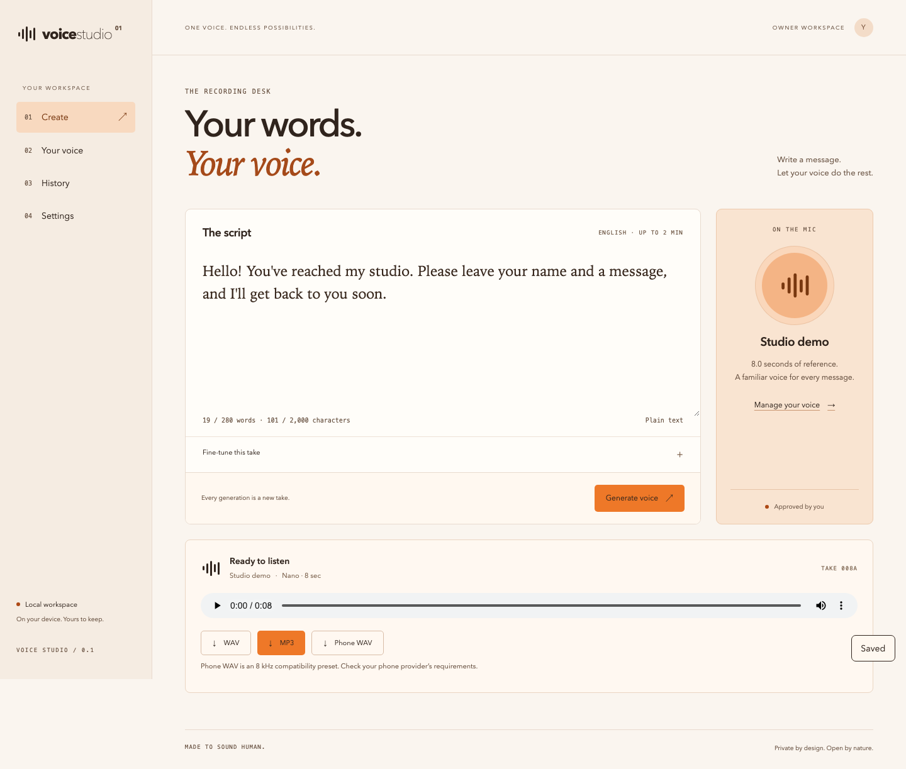

# Ozzy · Voice Studio

**Your voice. Your words. A private workspace for creating speech.**



*An actual screenshot of the application using a disposable demo workspace and synthetic test audio. It illustrates the interface, not a voice-quality benchmark.*

Ozzy is the repository for **Voice Studio**: an MIT-licensed application that turns an authorized reference recording into new English speech using **Chatterbox**. Use the browser on localhost, the native desktop shell, or an optional hosted workspace on Daytona. The interface and command remain `Voice Studio` and `voice` throughout the codebase.

**Current status: engineering preview.** The repository contains the application, tests, deployment automation, desktop packaging, and release tooling. Local verification has been performed; live Daytona qualification, owner voice-quality approval, signed releases, and clean-machine platform acceptance remain separate gates. See [verification](#verification-and-release-status).

[Get started](#run-locally) · [Create your first take](#create-your-first-take) · [Hosted setup](#host-on-daytona) · [Desktop](#desktop-app) · [Contributing](CONTRIBUTING.md) · [MIT license](LICENSE)

## What you can do

- **Prepare a reference voice.** Import audio, preview it, choose a clean excerpt longer than five seconds and up to thirty seconds, and confirm permission to use the recording.
- **Audition before approving.** Generate a sample and play it before activating that reference for future messages. Voice versions are immutable.
- **Generate English speech.** Write a script, choose a model, and create a take. The default is CPU Chatterbox Nano; Turbo and Original are available locally after installation.
- **Adjust generation.** Set a seed and temperature; Original additionally supports expression and guidance controls. Only model-supported controls appear.
- **Preview and export.** Listen without autoplay and download MP3, WAV, or an 8 kHz mono telephone WAV. The pipeline normalizes loudness and checks finished artifacts.
- **Keep a history.** Review completed takes, export them again, cancel active work, and delete voices or takes.
- **Move a reference explicitly.** Export a reference ZIP, extract `reference.wav`, and import it into another workspace. Changing workspaces does not transfer recordings automatically.
- **Work locally.** SQLite, recordings, and generated audio stay on your computer. After installing the runtime and model assets, generation uses local files; failed local inference does not upload work to a hosted fallback.
- **Launch a hosted studio.** Set up, start, inspect, back up, stop, recover, update, and roll back a Daytona deployment through the CLI or launch controls.
- **Integrate with scripts.** Submit jobs through an authenticated HTTP API or the CLI; use idempotency keys for retries and revoke integration keys in Settings.

The application currently targets short messages: **2,000 characters, 280 words, and up to 120 seconds of generated audio**. Reference uploads are limited to 50 MiB and ten minutes before excerpt selection. Quality and generation time depend on the reference, model, hardware, and script; there is no real-time performance guarantee.

## Run locally

### 1. Install prerequisites

| Tool | Version / purpose |
| --- | --- |
| Node.js and npm | Node **24.13.0**, also recorded in `.nvmrc`; builds the shared interface |
| Python | **3.11**; the workspace excludes Python 3.12 and later |
| uv | Python environment and locked dependencies; CI uses **0.11.7** |
| FFmpeg and ffprobe | Available on `PATH` for audio preparation and exports |
| Git | Source checkout and pinned inference dependency installation |

See [uv installation](https://docs.astral.sh/uv/getting-started/installation/) if it is not installed. The ordinary localhost setup runs processes directly on your computer: **it does not require Docker, create a container, or start PostgreSQL**.

### 2. Clone and build

```sh
git clone https://github.com/splitintech/ozzy.git
cd ozzy
npm ci
npm run build
uv sync --locked --all-packages --extra inference
```

Inference dependencies are substantial. Allow room for the Python environment, model downloads, temporary staging files, and your recordings. A private repository requires GitHub access before cloning.

### 3. Install Nano and start

```sh
uv run --no-sync voice models install nano
uv run --no-sync voice local --device cpu
```

Open the displayed address, normally **http://127.0.0.1:8765**, and enter the local access key printed in that terminal. Keep the process running while you use the studio. Use `--port 8766` if another process occupies the default port.

Model files are pinned by revision and verified against committed checksums. Approximate downloads are 3.0 GB for Nano, 4.0 GB for Turbo, and 3.2 GB for Original, in addition to the inference environment and temporary download space. Install another model explicitly:

```sh
uv run --no-sync voice models install turbo
uv run --no-sync voice models install original
uv run --no-sync voice models status
uv run --no-sync voice doctor --check-acceleration
```

CPU is the default. `voice local --device mps` or `--device cuda` selects an accelerator explicitly; a compatible device, runtime, and model path must be available. These commands do not imply that every platform/model combination has been qualified.

## Create your first take

1. Open **Your voice** and choose a recording you own or are authorized to use.
2. Enter a reference name, listen to the source preview, and select a clean excerpt **longer than 5 and no longer than 30 seconds**. Confirm authorization and select **Prepare reference**.
3. Select **Generate audition**. Wait for it to finish and play the audition. If it sounds appropriate, choose **Approve this voice**.
4. Open **Create**, enter your message, and optionally expand **Fine-tune this take**. Start with Nano and its default settings.
5. Select **Generate voice**. Progress shows queueing, model loading, generation, and audio processing. The first take can take longer because it loads the model.
6. Play the result, then export **MP3**, **WAV**, or **Phone WAV**. Check your phone provider's requirements before using the telephone export.
7. Open **History** to revisit or remove a take. Manage references, model installation, API keys, usage estimates, and hosted launch options in their corresponding workspace screens.

Use a clear, single-speaker reference with minimal noise. The audition gate confirms that you listened; it cannot determine consent or certify voice quality for you. Perth watermarking remains enabled in the inference stack.

## Local storage and access keys

By default, the database is `data/studio.sqlite3`, audio is under `data/objects/`, and installed models are under `models/`. Paths are configurable. Local history has no automatic age-based expiry. Deleting content explicitly still removes it according to the application's cleanup rules.

The local key uses **32 cryptographically random bytes**: a URL-safe value in the CLI and a hexadecimal value in the desktop launcher. The browser holds its key in memory rather than persistent browser storage. The desktop keeps the service token behind the native bridge.

Local owner keys now have a **fixed eight-hour lifetime**, measured from first registration in that workspace. Activity does not extend it. The sign-in screen displays the deadline, and the server enforces expiry on both studio requests and localhost launcher operations.

- Restart `voice local` to obtain a fresh automatically generated key, or reopen the local workspace in the desktop app.
- If you set `VOICE_LOCAL_TOKEN`, replace or unset it before restarting. Reusing it does not renew its persisted deadline.
- `VOICE_LOCAL_TOKEN_TTL_SECONDS` accepts **60–86400 seconds**. There is no unlimited value. Increasing the setting does not extend an already issued key.
- Expiry blocks subsequent authenticated requests; already accepted background work may finish. Saved voices and takes remain intact.
- Integration API keys created in Settings are separate, revocable credentials; they do not inherit the local owner key's expiry policy.

This policy is part of the current source. Previously built runtime bundles must be rebuilt or updated and restarted to receive it; a browser refresh does not update a running backend.

Copy `.env.example` to `.env` only if you need configuration overrides. Leave `VOICE_LOCAL_TOKEN` empty for automatic keys. Never commit configured credentials or recordings.

## Choose a deployment profile

| Profile | Runtime and database | Audio storage | Intended use |
| --- | --- | --- | --- |
| `local` | Local Python service/worker and SQLite | Local files | Private localhost or desktop workspace |
| `hosted_daytona_single` | UI, API, PostgreSQL 17, and CPU Nano in one persistent Daytona sandbox | Daytona volumes; encrypted database checkpoints on a separate volume | Default automated hosted setup; **live Daytona qualification pending** |
| `hosted_external` | Separate Daytona controller and inference worker; external PostgreSQL | External S3-compatible object storage | Advanced manual deployment |

The profiles are distinct workspaces. Selecting a hosted profile does not migrate your local SQLite database or silently upload your local references.

## Host on Daytona

### First setup

You need a Daytona account/API key, sufficient region quota, and a functioning OS credential store on the launcher machine. Provisioned resources incur provider charges. Setup uses **4 vCPU, 8 GiB RAM, 20 GiB disk, CPU Nano, and one concurrent generation**; it does not silently increase resources or enable GPU.

Review the proposed setup without provisioning:

```sh
uv run --no-sync voice cloud setup --deployment my-studio --source . --dry-run --json
```

Then run:

```sh
uv run --no-sync voice cloud setup --deployment my-studio --source .
```

Setup prompts securely for a Daytona API key and an owner password, builds the approved source context remotely, creates or reuses the snapshot and volumes, starts the sandbox, initializes/restores PostgreSQL, runs migrations, verifies API readiness, and opens a private studio URL. Local Docker and a separate registry account are not required. Nano loads on the first generation, so API readiness and model readiness are distinct.

Repeated setup reconciles the existing deployment. Normal starts reuse its snapshot and installed weights. A functioning credential store is required; setup does not fall back to plaintext credential persistence.

For noninteractive use, see the protected `--config` input and `--no-open`/`--json` options in the [hosted operating guide](docs/daytona-single.md). Keep signed preview URLs private. The hosted page also requires the owner login.

### Start, inspect, back up, and stop

```sh
uv run --no-sync voice cloud start --deployment my-studio --open
uv run --no-sync voice cloud status --deployment my-studio
uv run --no-sync voice cloud backup --deployment my-studio
uv run --no-sync voice cloud stop --deployment my-studio
```

In localhost **Settings**, use **Set up hosted studio** or **Start hosted studio**. For a development checkout, select **Advanced setup → Source directory** and enter this checkout's path. The hosted workspace opens in a separate tab. Desktop runtimes package the approved source context and provide corresponding native launch actions.

The combined sandbox checkpoints and stops after ten idle minutes with no outstanding work. Polling status does not count as activity. PostgreSQL's live cluster stays on sandbox-local disk, while recordings, results, and the latest two verified encrypted checkpoints use persistent volumes. Live PostgreSQL tables are never stored on the volume's FUSE filesystem.

Authoritative mutations are acknowledged only after the profile's checkpoint publication step succeeds. The intended recovery target remains conditional on actual Daytona volume behavior. Local container tests are not proof of provider durability.

### Recovery and upgrades

```sh
uv run --no-sync voice cloud recovery-export my-studio.vsr --deployment my-studio
uv run --no-sync voice cloud recovery-import my-studio.vsr
uv run --no-sync voice cloud restore --deployment my-studio
uv run --no-sync voice cloud update . --deployment my-studio
uv run --no-sync voice cloud rollback --deployment my-studio
```

Export a recovery bundle while you still have access to the deployment, and protect it with a separate passphrase. Import is for a replacement launcher; `restore` is for confirmed sandbox loss. Use `start` for an existing stopped sandbox. Recovery depends on retaining the volumes and recovery keys; account-wide or volume deletion is outside that guarantee.

Updates validate an isolated candidate and stop the old writer before replacing it. Rollback requires a schema-compatible image and preserves the newest checkpoint; these commands do not silently select historical data that would discard later acknowledged changes.

In the single-sandbox profile, hosted references, scripts, and outputs expire after thirty days. Reads enforce expiry immediately; physical cleanup runs while active and on the next start, so files may remain physically stored longer while stopped. The external profile has its own retention behavior documented in the [manual deployment runbook](docs/deployment.md).

See [the complete hosted guide](docs/daytona-single.md) for storage, deletion, fault recovery, explicit destruction, and cost-estimate limitations. **Daytona verification remains pending**; do not interpret this repository publication as completion of the live-provider acceptance gates.

## Desktop app

The Tauri shell shares the React interface and starts a separately installed Python runtime. It handles native HTTP, the OS credential store, runtime download verification, updates, and rollback. Application source is provided; this repository is not a claim that signed production installers are available.

For development, first complete the local source setup, then install the platform's [Tauri prerequisites](https://v2.tauri.app/start/prerequisites/) and the repository's Rust **1.90.0** toolchain.

macOS shell:

```sh
VOICE_DEV_EXECUTABLE="$PWD/.venv/bin/voice" npm run desktop:dev
```

Windows PowerShell:

```powershell
$env:VOICE_DEV_EXECUTABLE = (Resolve-Path .venv/Scripts/voice.exe).Path
npm run desktop:dev
```

The executable override is disabled in release builds. Production runtime installation verifies an Ed25519 signature, platform, archive size, checksum, extraction paths, and disk space before activation. Runtime/model installation is separate from the native shell. Build and qualify installers on their target operating systems.

See [release packaging](docs/release.md) for FFmpeg provenance, runtime archives, preview installers, signing/notarization, updates, rollback, and stable-release requirements.

## API and CLI

The API uses versioned routes including `/v1/voices`, `/v1/generations`, `/v1/artifacts`, `/v1/capabilities`, and `/v1/session`. Generation returns a job ID; clients poll until completion and download verified artifacts. Supply `Idempotency-Key` for retryable mutations. Keep bearer credentials and signed hosted URLs out of logs.

Create an integration key in **Settings** and supply it through a protected environment as `VOICE_API_KEY` (or use a valid `VOICE_LOCAL_TOKEN`). Then:

```sh
uv run --no-sync voice generate \
  --voice-id YOUR_APPROVED_VOICE_ID \
  --text "Hello, please leave your name and a message." \
  --model nano \
  --output message.mp3
```

Use `--url` to select a running hosted studio; preserve its private signed URL. Use `--idempotency-key` when retrying an uncertain CLI submission. Generate the reference and approve its audition before submitting messages.

Explore commands with `voice --help`, `voice cloud --help`, and `voice models --help` inside the environment. `voice password-hash` provides protected owner-password hashing for advanced hosted configuration.

The committed [OpenAPI specification](contracts/openapi.json) generates the frontend contract:

```sh
uv run --no-sync python scripts/export_openapi.py
npm run client:generate
```

## Development and testing

For lightweight API/UI development without model inference:

```sh
uv sync --locked --all-packages
npm ci
```

For a live UI development session, run these in separate terminals:

```sh
uv run --no-sync voice local --dev
```

```sh
npm run dev
```

The `--dev` option permits the configured localhost Vite origins. Use the inference sync command from [local setup](#run-locally) again when you need real generation; lightweight environments intentionally omit Torch.

Run the existing checks:

```sh
uv run --no-sync pytest tests deploy/tests -m "not inference and not cloud"
npm run check
npx playwright install chromium
npm run test:e2e
cargo test --locked --manifest-path apps/desktop/src-tauri/Cargo.toml
```

Browser tests start a disposable local service and use a synthetic fixture engine. They exercise import, audition, approval, generation, exports, deletion, keyboard access, accessibility, and hosted-launch UI behavior without using personal recordings. PostgreSQL tests require `VOICE_TEST_POSTGRES_URL` pointing to a disposable test database; additional dump/restore drills require their documented container setup. Do not aim test fixtures at production state.

## Verification and release status

The latest local-access-key change passed **180 Python tests** (excluding the separate PostgreSQL suite), **18 UI tests**, TypeScript/production build checks, and **six desktop/mobile browser tests**. Earlier verification also covers native compilation/tests, PostgreSQL, packaging, real Nano inference, and combined-runtime container recovery. Those are dated observations with their own scope, not new runs against every subsequent source change.

| Evidence | Details |
| --- | --- |
| General implementation | [Implementation audit](docs/implementation-audit.md) |
| Local runtime checks | [Verification notes](docs/verification.md) |
| Single-sandbox implementation and container tests | [Daytona single-sandbox evidence](docs/daytona-single-evidence.md) |
| Live-provider acceptance | [Daytona qualification](docs/daytona-qualification.md) |
| Owner voice quality and performance | [Qualification procedure](docs/qualification.md) |
| Signed distribution | [Release guide](docs/release.md) |

Live Daytona remote build, generation, restart, sandbox-loss recovery, cross-sandbox visibility, and measured costs still require account-backed evidence. Owner voice quality, signed clean-machine installs, and Windows/MPS/CUDA qualification are separate release gates. Detailed generated logs and private test audio remain outside the source repository.

## Troubleshooting

| Symptom | What to do |
| --- | --- |
| Local key expired | Restart with a fresh key; replace or unset a configured `VOICE_LOCAL_TOKEN`. An old runtime must be rebuilt/restarted to receive the expiry feature. |
| Model missing or Torch unavailable | Repeat the inference `uv sync` command, then install the selected model. Ordinary lightweight sync does not install inference dependencies. |
| FFmpeg/ffprobe missing | Install both and confirm they are on `PATH`; `voice doctor` reports runtime readiness. |
| Generation stays in loading | The first take loads model weights. Inspect available memory and the selected device; CPU performance varies. |
| Reference cannot be prepared | Check the upload size, source duration, excerpt bounds, and authorization checkbox. |
| Approval button disabled | Generate an audition and play it before approving. |
| Hosted setup reports quota or credential-store failure | Resolve the reported account/region quota or OS keychain issue; setup does not silently increase resources or write plaintext secrets. |
| Hosted storage unavailable or recovery required | Follow the recovery instructions in the hosted guide. Do not create a competing writable sandbox or discard the latest checkpoint. |

## Repository layout

```text
apps/studio/       Shared React/Vite interface and TypeScript API client
apps/desktop/      Tauri shell, native bridge, keychain and runtime management
python/core/       Configuration, contracts, migrations, audio and storage
python/engine/     Chatterbox adapter, isolated runner and pinned model installer
python/service/    FastAPI, authentication, jobs, worker and Daytona lifecycle
python/cli/        Local launcher, generation client and hosted commands
contracts/        Generated OpenAPI contract
deploy/            Docker targets, packaging, signing and source inventories
scripts/           Build, benchmark, verification and release tooling
tests/             API, storage, lifecycle, expiry and browser regression tests
benchmarks/        Script set and example cost inputs
docs/              Operating guides, architecture, evidence and UI banner
.github/workflows/ Native/browser checks, containers and release gates
```

## License and contributions

The application source is licensed under the **[MIT License](LICENSE)**. Existing copyright notices are preserved. Chatterbox, model weights, Perth, PyTorch, FFmpeg, and other components retain their own license terms and notices; the application license does not relicense dependencies or grant rights to someone else's voice. See [third-party notices](THIRD_PARTY_NOTICES.md).

Please read [CONTRIBUTING.md](CONTRIBUTING.md) before submitting changes. Keep credentials, private recordings, databases, model weights, generated runtime bundles, and local caches out of source commits.
