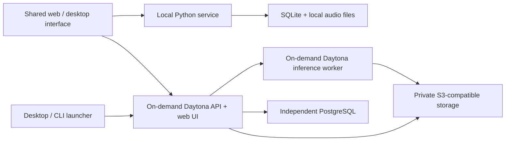

# Open-source Voice Studio: Chatterbox, Daytona, and desktop apps

## 1. Confirmed product and architecture

Build a **standalone MIT-licensed monorepo** that turns an authorized reference MP3 into a reusable voice for generating new English speech.

The first release supports one owner, one brand voice, and short voicemail scripts. The workflow is:

**Import reference → enter script → generate → listen → regenerate if needed → export MP3/WAV.**

| Area | Agreed direction |
|---|---|
| Initial use | Generate voicemail audio for export; telephone delivery comes later |
| Future consumers | Cura, Legal Voice, and animation checkpoints through a reusable API |
| Interface | The same minimal interface in the browser and desktop app |
| Desktop targets | Apple Silicon macOS `.dmg` and Windows x64 `.exe` |
| Local operation | Download engine/model packs on first use; subsequently work offline |
| Hosted operation | Desktop or CLI starts Daytona application services on demand |
| Compute selection | Benchmark CPU first; use GPU only when measurements justify it |
| Performance | Target approximately 30 seconds for a 30–60-second message once the engine is ready |
| Budget | Aim below $50/month; establish a deployment budget from measured costs |
| Storage | Independent hosted PostgreSQL and S3-compatible storage; local SQLite and files |
| Privacy | Explicit transfers between local and hosted modes |
| History | Hosted scripts/audio expire after 30 days; references remain until deleted |
| Distribution | Signed stable installers; separately labeled previews during qualification |

**Hosting consequence:** the hosted API is available during an active Daytona session. The desktop, CLI, or a future server-side SDK must start that session before submitting requests. There is no continuously running gateway in v1.

The existing SplitIn code provides useful patterns for caching, audio preparation, and TTS interfaces. The new implementation will have its own packages and contracts. Existing SplitIn integrations remain a later milestone.

### Technical structure

Use three principal application areas:

- `apps/studio`: React, TypeScript, and Vite interface shared by web and desktop.
- `apps/desktop`: Tauri shell, credential storage, downloads, local process management, and Daytona startup.
- `python`: separately installable packages for the inference engine, FastAPI service, CLI, and deployment orchestration.

Use npm workspaces for JavaScript packages and a `uv` workspace for Python. Keep the lightweight API dependencies separate from PyTorch and model dependencies. This permits small hosted controller containers and independently packaged inference engines. [uv workspaces](https://docs.astral.sh/uv/concepts/projects/workspaces/), [FastAPI containers](https://fastapi.tiangolo.com/deployment/docker/)

## 2. Step-by-step implementation

### Step 1 — Establish reproducible foundations

Create the standalone repository, workspace configuration, contribution guide, example configuration, and development commands.

Use Python 3.11 as the initial compatibility baseline. Pin the Chatterbox source revision, model revisions, Python dependencies, container digests, and desktop toolchain. Resolve upstream Git dependencies to immutable commits.

Do not depend on an unpinned `pip install` or assume the published package contains every feature shown on the current development branch. The official repository currently documents Original, Turbo, and Nano variants, while its dependency file includes a moving Git dependency that must be locked for reproducibility. [Chatterbox installation](https://github.com/resemble-ai/chatterbox#installation), [upstream dependencies](https://github.com/resemble-ai/chatterbox/blob/master/pyproject.toml)

**Acceptance:** clean checkouts produce the same dependency resolution, and the lightweight API starts without loading PyTorch.

### Step 2 — Qualify Daytona and benchmark the models

Verify account access, CPU limits, GPU quota, image availability, and storage access before choosing production resources.

Run the same reference recording and test scripts through:

| Candidate | Purpose |
|---|---|
| Chatterbox Original | Establish voice-quality and expressive-control baseline |
| Chatterbox Turbo | Evaluate faster English generation |
| Chatterbox Nano | Evaluate smaller, CPU-oriented inference |

Start with a four-vCPU CPU configuration. Test eight vCPUs only if the account permits it. Reduce CPU allocation when a smaller configuration still passes. Add a single on-demand NVIDIA GPU comparison only when CPU candidates fail the quality or speed criteria.

Daytona documents default resource limits that require account verification before assuming an eight-core allocation. Resemble’s Nano speed claims are useful starting evidence, not measurements for this application. [Daytona resources](https://www.daytona.io/docs/en/sandboxes/#resources), [Nano model card](https://huggingface.co/ResembleAI/chatterbox-nano)

Measure separately:

- Sandbox creation and image startup.
- Model loading and reference preparation.
- Generation, audio processing, and upload.
- Peak memory and complete billable runtime.
- Naturalness, speaker similarity, pronunciation, omissions, and repetitions.

Use 20 representative scripts covering names, phone numbers, dates, abbreviations, questions, and 30–60-second messages. Evaluate multiple seeds.

**Selection rule:** select the least expensive measured configuration that passes the quality gate and the warm performance target. Quality requires owner approval, average naturalness and similarity scores of at least 4/5, and no incorrect critical names or numbers in the acceptance set. If nothing qualifies, report the specific shortfall before declaring hosted performance ready.

### Step 3 — Implement reference-audio preparation

Support MP3 and WAV import with actual decoding and file validation.

Preserve the original privately, then:

1. Inspect duration, channels, sample rate, clipping, and silence.
2. Let the owner select a clean, single-speaker excerpt.
3. Recommend approximately 10–15 seconds.
4. Convert the selected excerpt to the model’s required mono waveform.
5. Save its checksum, preparation version, and authorization acknowledgment.
6. Generate an audition before activating the voice.

Turbo/Nano currently require a reference longer than five seconds. Enforce model-specific requirements from the pinned implementation. [Official reference preparation code](https://github.com/resemble-ai/chatterbox/blob/master/src/chatterbox/tts_turbo.py)

Use immutable voice versions: replacing the reference creates a new version rather than changing the meaning of previous jobs.

**Acceptance:** malformed files, silent clips, and insufficient references produce useful errors; a valid MP3 produces an audition and an identifiable voice version.

### Step 4 — Build one portable Python inference engine

Expose a common engine interface for Original, Turbo, and Nano:

- Load a pinned model from local files.
- Prepare reference conditioning.
- Generate speech from supplied text.
- Return audio and generation metadata.
- Report supported devices and controls.

Use CUDA for qualified hosted GPU configurations, validated MPS acceleration on Apple Silicon, and CPU support for local operation. Local failures must never silently upload audio to hosted infrastructure.

Serialize generation within each worker because upstream model instances maintain mutable reference conditioning.

For messages approaching two minutes, segment at sentence boundaries using tested model limits. Reuse the same voice conditioning and assemble the complete result without cutting words or silently truncating text.

Expose only controls supported by the selected model. In particular, Turbo/Nano do not implement all of Original’s CFG and exaggeration controls. [Original implementation](https://github.com/resemble-ai/chatterbox/blob/master/src/chatterbox/tts.py), [Turbo/Nano implementation](https://github.com/resemble-ai/chatterbox/blob/master/src/chatterbox/tts_turbo.py)

**Acceptance:** the same engine package runs through local Python, the native desktop runtime, and Daytona containers.

### Step 5 — Add audio finishing and exports

Keep a lossless master at the model’s native sample rate. Apply restrained finishing: silence handling, short edge fades, loudness normalization, and peak control.

Initial product defaults:

- Mono speech normalization targeting −19 LUFS and a −1 dBTP ceiling.
- MP3 export: mono, 44.1 kHz, 128 kbps.
- WAV export: mono PCM16 at the native sample rate.
- Optional telephone-format export: 8 kHz mono PCM16 WAV, labeled as a compatibility preset whose suitability depends on the eventual phone provider.

Use explicit FFmpeg conversion settings and verify exported files by decoding them again. Keep model watermarking enabled and test the effects of export processing without promising detection under every transformation. [FFmpeg audio filters](https://ffmpeg.org/ffmpeg-filters.html#loudnorm), [PerTh watermarking](https://github.com/resemble-ai/Perth)

Record the model revision, voice version, seed, settings, duration, and processing version alongside each result. Regeneration creates a separate take.

**Acceptance:** exports contain the complete message, play successfully, and meet the selected audio profile.

### Step 6 — Implement the API, queue, and persistence

Use FastAPI with a versioned API and generated TypeScript client.

| Interface | Responsibility |
|---|---|
| `/v1/capabilities` | Available models, supported controls, limits, and runtime readiness |
| `/v1/voices` | Import, inspect, activate versions, and delete the reference voice |
| `/v1/generations` | Submit text, voice version, model profile, and generation options |
| `/v1/generations/{id}` | Read progress, errors, timings, and completed artifacts |
| `/v1/generations/{id}/cancel` | Cancel queued or running work |
| `/v1/artifacts/{id}` | Authorized preview and export |
| Health/readiness endpoints | Distinguish a running API from a ready inference engine |

Generation returns `202 Accepted` and a job ID. Use polling for v1 progress; streaming speech is outside this release.

Persist job states such as `queued`, `starting`, `loading`, `generating`, `processing`, `completed`, `failed`, and `cancelled`.

Implement:

- One active inference worker per deployment.
- A bounded queue and idempotent submissions.
- Durable job leases and attempt identifiers.
- Bounded retries for transient infrastructure failures.
- Cancellation that actually stops inference.
- Completion only after artifacts are durably stored.
- Recovery of interrupted jobs without duplicate published results.

Use PostgreSQL for hosted metadata and queue coordination, avoiding a separate Redis dependency at this scale. Use SQLite for local installations.

Keep hosted script bodies in expiring private objects, rather than indefinitely retained metadata or logs. Enforce artifact expiration in the API and configure storage lifecycle deletion.

**Acceptance:** restarting the API or losing a worker cannot turn an incomplete file into a successful result.

### Step 7 — Implement Daytona’s on-demand lifecycle

Provide these user-facing commands:

- `voice local`
- `voice cloud start`
- `voice cloud status`
- `voice cloud stop`
- `voice generate`
- `voice models install`

The desktop exposes equivalent actions.

Hosted operation:

1. The launcher authenticates to Daytona using owner-managed credentials.
2. It discovers or creates the application session from a pinned image.
3. The small controller serves the web UI and authenticated API.
4. A generation request starts the selected inference worker.
5. The worker loads cached models and processes queued work.
6. Results are committed to independent storage.
7. The inference worker stops when the queue is empty.
8. The controller stops after ten minutes without owner activity and with no outstanding jobs.

Status polling must not keep the application alive indefinitely. Configure finite lifecycle deadlines as a backstop, protect active jobs from accidental idle shutdown, and clean up orphaned workers on the next launch.

Daytona’s idle detection does not treat an internal inference process as activity. GPU sandboxes are deleted when stopped. Both behaviors require explicit lifecycle handling. [Daytona automated lifecycle](https://www.daytona.io/docs/en/sandboxes/#auto-stop-sandboxes), [sandbox billing](https://www.daytona.io/docs/en/billing/)

Keep Daytona credentials and sandbox-wide preview tokens out of the browser application. Use expiring, port-scoped signed URLs for browser access, plus application authentication. [Daytona preview authentication](https://www.daytona.io/docs/en/preview/)

Use snapshots or volumes for reusable model assets, with benchmarked local staging when beneficial. Do not put SQLite or PostgreSQL database files on Daytona’s FUSE volumes. [Daytona volume limitations](https://www.daytona.io/docs/en/volumes/#limitations)

**Acceptance:** demonstrate start → generate → download → stop, then recreate the runtime and recover the stored voice and history.

### Step 8 — Build the minimal shared interface

Use a restrained neutral design with four areas:

- **Create:** script editor, selected voice, generate button, progress, playback, and export.
- **Voice:** reference import, excerpt selection, audition, and replacement.
- **History:** previous scripts, takes, downloads, and deletion.
- **Settings:** local/hosted mode, runtime installation, connection status, and advanced options.

Display startup, model loading, queueing, and generation as distinct states. Use phase-based progress rather than invented percentages.

Keep advanced synthesis settings collapsed. Show an explicit transfer action before uploading a local reference or script to hosted mode.

Provide keyboard operation, labeled controls, visible focus, accessible errors, and no automatic audio playback. Test against relevant WCAG 2.2 AA requirements. [WCAG 2.2](https://www.w3.org/TR/WCAG22/)

**Acceptance:** a new user can import a voice and export a message without a terminal or knowledge of model parameters.

### Step 9 — Package native desktop operation

Use Tauri with a platform-specific Python runtime package. Tauri officially supports Python programs packaged as external executables; each target requires its own binary. [Tauri sidecars](https://v2.tauri.app/develop/sidecar/)

On first local use:

1. Detect platform and available acceleration.
2. Show download size and disk requirements.
3. Download a signed runtime manifest and verified engine pack.
4. Download model assets pinned to exact revisions.
5. Verify integrity and install atomically.
6. Run a local readiness check.

Build the Python runtime as a PyInstaller directory bundle on each target OS. Include required libraries and FFmpeg; do not depend on the user’s Python installation or shell path. [PyInstaller operating model](https://pyinstaller.org/en/stable/operating-mode.html)

Run the local service on loopback with a per-launch credential. Have Tauri manage its startup, requests, shutdown, and crashes through narrowly scoped native commands.

**Acceptance:** clean macOS and Windows machines generate audio after first setup, then repeat the workflow with networking disabled.

### Step 10 — Complete owner access and data lifecycle

Hosted mode uses one owner account, secure sessions, login throttling, and revocable API keys. Local desktop mode requires no cloud account.

Keep references private and exclude them from:

- Git history.
- Container images.
- Public releases.
- Shared model caches.
- Diagnostic logs.

Store desktop credentials in OS-protected storage. Protect local endpoints from unauthorized browser requests and limit file access to selected imports and application directories.

Provide explicit deletion of voice versions, their conditioning caches, scripts, and results. Do not accept executable or pickled voice bundles from users; portable voice exports contain validated audio and application metadata.

**Acceptance:** expired or deleted content cannot be retrieved, and local-to-hosted transfer occurs only through an explicit action.

### Step 11 — Build verification and release pipelines

Run ordinary unit and contract tests without downloading models. Maintain a separate inference qualification suite using pinned models and authorized test audio.

Release artifacts include:

- Source distributions and documented development setup.
- CPU container image; CUDA image when qualified.
- macOS DMG and Windows EXE.
- Engine/model manifests and checksums.
- Dependency notices, software bill of materials, and release notes.

Sign and notarize the macOS application and downloaded executable components. Sign Windows executables and installers. Treat Tauri update signatures separately from operating-system code signing. [macOS signing](https://v2.tauri.app/distribute/sign/macos/), [Windows signing](https://v2.tauri.app/distribute/sign/windows/), [Tauri updater](https://v2.tauri.app/plugin/updater/)

**Acceptance:** stable releases pass clean-machine installation, signature verification, update, rollback, and offline-generation checks.

### Step 12 — Pilot, measure cost, and publish

Pilot with the owner’s actual reference and voicemail scripts.

Publish a benchmark report containing hardware, pinned revisions, quality scores, cold/warm timings, memory use, and measured cost per completed message.

Calculate the monthly forecast from:

**controller runtime + inference runtime + startup/teardown + storage + database + transfer + retries.**

Daytona’s published pricing is per second. As an illustration, eight vCPUs and eight GiB total approximately $0.5328/hour at the rates reviewed—about $0.0044 for 30 seconds of allocated runtime. This excludes startup, storage, other services, and account-specific constraints. [Daytona pricing](https://www.daytona.io/pricing)

Choose the deployment budget from pilot results before public operation. Include spend alerts and a configurable admission limit.

After v1, add separately qualified adapters for Cura/Legal Voice and animation audio. Live conversational streaming and telephone delivery each require their own acceptance criteria.

## 3. Test and acceptance matrix

| Area | Required scenarios |
|---|---|
| Reference import | Valid MP3/WAV, malformed file, silence, clipping, insufficient duration, unsupported content |
| Speech quality | Speaker recognition, naturalness, names, numbers, complete sentences, no unwanted repetition |
| Segmentation | Sentence boundaries, maximum script, pauses, complete final sentence, no silent truncation |
| Exports | Decode validation, duration, loudness, peak level, playback, watermark-processing regression |
| Model controls | Unsupported controls unavailable; actual selected model recorded |
| Queue | Duplicate submission, queue limit, cancellation, retry, worker loss, controller restart |
| Daytona | Missing quota, capacity unavailable, startup timeout, credential expiry, cleanup failure |
| Persistence | Recreated runtime recovers data; expired/deleted assets inaccessible |
| Desktop | Clean installation, interrupted download, corrupt pack, insufficient disk, engine crash |
| Offline operation | Successful generation without network access after initial setup |
| Authentication | Unauthorized reads/writes, revoked keys, expired sessions, local endpoint protection |
| UI | Keyboard workflow, accessible status/errors, explicit mode transfer, no autoplay |
| Release | Signed installers, verified updates, rollback, dependency notices |

The warm performance gate is **p95 ≤30 seconds for the agreed 30–60-second message set, with the engine ready and no preceding queued work**. Cold-start and queue delays are measured and displayed separately. Local CPU performance is published per tested hardware rather than held to the hosted target.

## 4. Assumptions and release boundaries

- **Working name:** Voice Studio; branding can change without altering the architecture.
- The reference is authorized and available, but its actual file has not yet been inspected.
- “Create a voice” means reference-conditioned synthesis, without training a custom checkpoint.
- V1 accepts short, owner-authored English scripts; batch personalization and long-form narration are deferred.
- Application compute runs on Daytona. Hosted PostgreSQL and object storage remain independent, as selected.
- Local and hosted histories remain separate.
- Hosted service availability is session-based; a stopped service requires launcher/SDK startup.
- No model inference, Daytona provisioning, installer build, or performance test has been performed during this planning work.
- Production readiness requires measured model qualification, lifecycle recovery proof, and signed installer verification—not merely a successful local demo.
